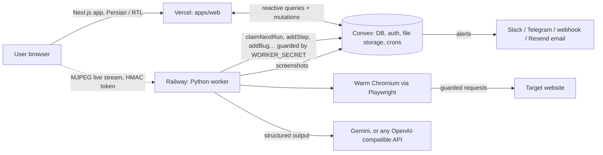

# 2. Technical and infrastructure documentation

QAgent tests web user flows as a black box: given a URL and a goal in Persian, it plans scenarios, drives a real
browser, and returns an evidence-backed bug report. Everything below is taken from the code in this repository;
unknowns are listed explicitly.

## System architecture



| Part | Path | Stack | Responsibility |
|---|---|---|---|
| Web | `apps/web` | Next.js 16 App Router, React 19, Tailwind 4, next-intl (Persian only), Convex React client | UI, live run view via Convex subscriptions (no polling), report export in the browser |
| Backend | `convex/` | Convex functions + `@convex-dev/auth` (password) | Schema, auth, ownership checks, run queue, file storage for screenshots, crons, notifications, email |
| Worker | `apps/worker` | Python 3.12, LangGraph, LangChain, Playwright 1.63, Pydantic v2 | Claims queued runs, runs the agent, writes steps, bugs and cost back to Convex |

Data model (`convex/schema.ts`): `users`, `projects` (one per site origin per user), `runs`, `scenarios`, `steps`,
`bugs`, `integrations`, `workers` (heartbeats), plus Convex Auth tables.

## Agent execution flow

```
claim run → plan → fan-out execute_scenario (≤ SCENARIO_PARALLELISM) → report → finishRun
```

Defined in `apps/worker/qagent_worker/agent/graph.py`.

| Node | Model | Behaviour |
|---|---|---|
| plan | fast | Checks the URL is allowed, opens it, surveys the page, returns 2–5 scenarios (≥1 happy path, ≥1 negative/edge). On a re-run it reuses the original scenarios with no LLM call. |
| execute_scenario | fast | Observe → decide (a thought + 1–4 batched actions, or `done`) → act loop. Limits: 25 steps, 3 min per scenario. Captcha → `error` ("blocked"), never a bug. |
| verify (inside the scenario) | fast, then smart | Verdict `passed` / `failed` (site bug) / `agent_error` (agent stuck). Escalates to the smart model (text only) when not passed or confidence < 0.7. |
| report | fast | Persian summary, counts, cost. Skipped (fixed text) when the run made no LLM calls. |

**Observation** (`browser/observe.py`): an injected script tags visible interactive and meaningful elements with
stable `data-qa-ref` ids and returns one compact line per element. Actions target refs, falling back to role +
accessible name, then text.

**Evidence** (`browser/evidence.py`): console errors, uncaught exceptions, HTTP ≥ 400 and failed requests per page.
Bugs store recent step screenshots and the final screenshot.

**Replay** (`replay.py`): a passed scenario's actions are saved as role + accessible name selectors plus end-state
checks (URL path and key texts). "Re-run" replays them with zero LLM calls; on any mismatch the scenario falls back
to the agent. Failed scenarios always re-run with the agent.

**Live view** (`browser/live.py`): CDP screencast of the run's browser, served as MJPEG from the worker only while
someone watches. Access uses a per-run HMAC token derived from `WORKER_SECRET`. Requires `LIVE_URL`.

## Reliability

- Run queue: atomic claim in Convex; heartbeat on progress. A 30 s cron (`convex/crons.ts`) re-queues runs whose
  heartbeat is older than 90 s (one retry, two attempts total), then marks them failed. Queued runs fail after 10 min
  only when no worker has checked in.
- LLM calls (`llm.py`): up to 5 attempts with exponential backoff (or the provider's hinted delay) on 429 / 5xx /
  timeouts, one retry on unparseable output, then fall back to the other model. Provider failures are stored as a
  stable code (`LLM_CREDITS`, `LLM_AUTH`, `LLM_MODEL`, `LLM_RATE_LIMIT`, …) so the UI can explain them.
- Users can cancel; the worker stops within one step.
- Worker logs are JSON lines on stdout; `GET /health` on `$PORT` is the Railway health check.

## AI models and tools

| Role | Default | Configured by |
|---|---|---|
| Fast (plan, act, verify, report) | `gemini-3.8-flash`, thinking level low | `MODEL_FAST` |
| Smart (second opinion on failed / low-confidence verdicts) | `gemini-3.1-pro-preview` | `MODEL_SMART` |
| Provider | Google Gemini via `langchain-google-genai` | `LLM_PROVIDER=gemini` (default) |
| Alternative | Any OpenAI-compatible endpoint via `langchain-openai`, using function calling for structured output | `LLM_PROVIDER=openai_compatible`, `LLM_BASE_URL`, `LLM_API_KEY` |

Tools available to the agent are browser actions on the target page (`browser/actions.py`), not external APIs.
Which provider and models production actually uses is **unknown** from the repository (set in Railway env).

## Data sources

- The target website itself, observed through Playwright (DOM, accessibility roles, screenshots, console, network).
- The user's goal text and optional test credentials.
- Site favicon and title fetched once per new project (`convex/siteMeta.ts`).
- No third-party datasets, no scraping beyond the target site, no training on user data.

## Security

- Only public `http(s)` targets. Every browser request is checked: DNS-resolved IPs in private, loopback,
  link-local, CGNAT, metadata and IPv6 ULA ranges are blocked (`security.py`). Navigation is same-host only.
- Test credentials never reach the LLM: the model types `{{username}}` / `{{password}}` placeholders that are
  substituted at execution time; observations, thoughts, bugs and traces are scrubbed.
- Worker-facing Convex functions require `WORKER_SECRET`; user functions check ownership.
- Prompts instruct the agent never to pay.
- Known limits: DNS answers are cached per worker process, so DNS rebinding after the first lookup is not caught.
  Test credentials are stored in the `runs` table in plain form. There is no site ownership verification, so a user
  can point the agent at any public site.

## Infrastructure

| Service | Config in repo | Notes |
|---|---|---|
| Vercel | `apps/web/vercel.json`: region `fra1`, build runs `npx convex deploy --cmd 'pnpm build'` | Root directory `apps/web`; project `qagent-web` |
| Convex | `apps/web/convex.json` points at `../../convex/` | Deployed together with the web build |
| Railway | `apps/worker/railway.json` + `Dockerfile` (Playwright Python base image), restart always, health check `/health` | README recommends EU region; actual region **unverified** |
| Resend | `convex/email.ts` | Optional; report emails and weekly digest |

Scaling: each worker runs `MAX_CONCURRENT_RUNS` runs with one warm Chromium and a fresh context per scenario. More
throughput = more Railway replicas (claims are atomic).

## Deployment and setup

Local setup, deploy steps and acceptance checks are in the repository [README](../../README.md#local-setup).

## Environment variables

Names only. Never commit values.

| Variable | Where | Required | Purpose |
|---|---|---|---|
| `WORKER_SECRET` | Convex + worker | yes | Shared secret for worker functions and live-view tokens |
| `DAILY_RUN_LIMIT` | Convex | no (10) | Runs per user per 24 h |
| `JWT_PRIVATE_KEY`, `JWKS`, `SITE_URL` | Convex | yes | Set by `npx @convex-dev/auth` |
| `RESEND_API_KEY`, `EMAIL_FROM` | Convex | no | Email reports and weekly digest |
| `CONVEX_DEPLOY_KEY` | Vercel | yes | Lets the build deploy Convex and set `NEXT_PUBLIC_CONVEX_URL` |
| `NEXT_PUBLIC_CONVEX_URL` | Web | yes (local) | Convex URL; set automatically on Vercel builds |
| `NEXT_PUBLIC_SITE_URL` | Web | no | Canonical URL; falls back to the Vercel production URL |
| `CONVEX_URL` | Worker | yes | `.convex.cloud` URL |
| `WORKER_ID` | Worker | no (hostname) | Worker name in heartbeats |
| `MAX_CONCURRENT_RUNS` | Worker | no (2) | Runs per worker |
| `SCENARIO_PARALLELISM` | Worker | no (3) | Scenarios in parallel per worker |
| `LLM_PROVIDER` | Worker | no (`gemini`) | `gemini` or `openai_compatible` |
| `GOOGLE_API_KEY` | Worker | with Gemini | Gemini key |
| `LLM_BASE_URL`, `LLM_API_KEY` | Worker | with OpenAI-compatible | Endpoint and key |
| `MODEL_FAST`, `MODEL_SMART` | Worker | no | Model ids |
| `LLM_MAX_TOKENS` | Worker | no (no cap) | Output token cap |
| `PRICE_TABLE_JSON` | Worker | no | USD per 1M tokens per model, overrides defaults |
| `LIVE_URL` | Worker | no | Public URL of the worker port for the live view |
| `PORT` | Worker | no (8080) | Health check and live-view port |
| `ALLOW_PRIVATE_URLS` | Worker | never in prod | Local dev only: allow localhost targets |

Templates: `.env.example`, `apps/web/.env.example`, `apps/worker/.env.example`.

## Costs

**LLM (measured per run).** Token usage is read from each response, priced with the table below and stored on
`run.cost` (tokens, USD, call count), shown live in the UI. Replayed scenarios cost $0 in model fees.

| Model | Input $/1M | Output $/1M | Source |
|---|---|---|---|
| `gemini-3.8-flash` | 0.75 | 3.75 | `DEFAULT_PRICES` in `llm.py` (code notes these double on 2027-01-01) |
| `gemini-3.1-flash-lite` | 0.25 | 1.50 | `DEFAULT_PRICES` |
| `gemini-3.1-pro-preview` | 2.00 | 12.00 | `DEFAULT_PRICES` |

These are the prices configured in code; confirm against the provider's current price list before quoting them.
Models not in the table are costed at $0, so set `PRICE_TABLE_JSON` when using an OpenAI-compatible provider.

**Estimated LLM cost per agent run: about $0.22** (range $0.10–$0.50). This is worked out from the code paths
and the price table above, not measured. Replace it with the average of `run.cost.usd` once real runs exist.

| Call | Count per run (assumed) | Tokens in / out per call (assumed) | Cost |
|---|---|---|---|
| Plan (fast) | 1 | 6k / 1.5k | $0.010 |
| Decide steps (fast, text only) | 3.5 scenarios × 8 steps = 28 | 5k / 0.6k | $0.168 |
| Verify (fast, with final screenshot) | 3.5 | 5k / 0.5k | $0.020 |
| Report (fast) | 1 | 4k / 0.8k | $0.006 |
| Smart re-check (pro) | 1 | 4k / 1k | $0.020 |
| **Total** | | ~171k / ~22k | **≈ $0.22** |

A fully replayed re-run costs $0.00 in model fees. Estimated run duration: 2–4 minutes for 3–4 scenarios in parallel,
given the 3-minute per-scenario cap.

Estimated monthly infrastructure cost (assumed plan levels, check current pricing before relying on them):

| Item | Estimate | Assumption |
|---|---|---|
| Vercel | $0–20 | Hobby at MVP, Pro ($20/seat) once commercial |
| Convex | $0–25 | Free tier at MVP, paid tier when usage grows |
| Railway worker | $20–40 | One worker, ~2 GB RAM for Chromium, always on |
| Resend | $0 | Free tier covers MVP email volume |
| **Fixed total** | **$20–85 / month** | Excludes LLM usage |

## Benchmark

No benchmark has been run yet. The demo shop previously used for testing was removed. The numbers below are
**targets**, not results:

| Metric | Target |
|---|---|
| Detection rate on known, seeded bugs | ≥ 80% |
| False positives (site bug reported when none exists) | ≤ 10% of reported bugs |
| Median run time | ≤ 4 min |
| Median LLM cost per agent run | ≤ $0.25 |

Method: 10–20 public sites (or staging copies) with known issues, 3 runs each, recording `run.cost` and verdicts.

## Technical limitations

- Captcha, OTP and email-verification flows are out of scope (reported as "blocked", not as bugs).
- Replayed sign-ups reuse the original fake email; on sites that reject duplicates, the scenario falls back to the agent.
- Live view streams one page per run (the oldest open one) when scenarios run in parallel.
- Single worker region; DNS rebinding after the first lookup is not detected.
- No billing, plan enforcement beyond the daily quota, team accounts, scheduled runs or CI integration yet.
- No automated test suite beyond `llm.py`'s self-check and the `tests/test_secret.py` acceptance script.
- Persian-only UI.
