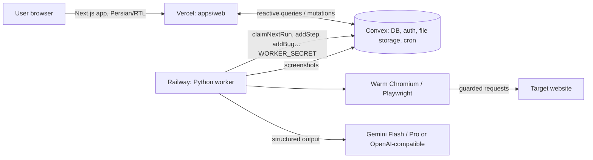

# QAgent — Technical document

QAgent is an AI agent that tests web user flows as a black box: give it a URL and a goal in Persian,
and it plans scenarios, drives a real browser, and returns an evidence-backed bug report.

## Architecture



- **apps/web** — Next.js App Router on Vercel (`fra1`). All live updates are Convex `useQuery` subscriptions; no
  polling, no SSE, no video.
- **convex/** — schema, Convex Auth (password), user functions with ownership checks, worker functions protected by
  `WORKER_SECRET`, and a 30 s cron that re-queues (1 retry) or fails runs whose heartbeat is older than 90 s.
- **apps/worker** — Python 3.12, LangGraph, Playwright (async Chromium), Pydantic v2. One warm browser per worker;
  a fresh context per scenario.
- **apps/demo-shop** — Persian shop with five switchable bugs (B1–B5) used for the demo and the benchmark.

## Agent flow

```
START → plan → fan-out execute_scenario (≤ SCENARIO_PARALLELISM) → report → END
```

| Node | Model | What it does |
|---|---|---|
| plan | fast | Observes the start page, returns 2–5 scenarios (≥1 happy path, ≥1 negative/edge). On a re-run it reuses the original scenarios with no LLM call. |
| execute_scenario | fast | Observe → decide (thought + 1–4 batched actions, or `done`) → act loop. Limits: 25 steps, 20 s/action, 3 min/scenario. Captcha → `error` ("blocked by captcha"), never a bug. |
| verify (inside execute_scenario) | fast → smart | Judges `passed` / `failed` (site bug) / `agent_error` (agent stuck). Escalates to the smart model when not passed or confidence < 0.7. |
| report | fast | Run summary in Persian; counts, cost. Skipped (template text) when the run made no LLM calls. |

**Observation.** An injected script tags visible interactive and meaningful elements (`a, button, input, select,
textarea, [role=…], headings, alerts`) with stable `data-qa-ref` ids and returns one compact line per element.
Actions target refs; if a ref is gone they fall back to role + accessible name, then text.

**Evidence.** Per page: console errors, uncaught exceptions, HTTP ≥ 400 and failed requests. Bugs store the last
step screenshots plus the final screenshot.

**Replay (self-healing re-runs).** When a scenario passes, its successful actions are saved with role + accessible
name (ref as fallback) and end-state checks (URL path + key headings/messages). "Re-run" replays those traces
deterministically with zero LLM calls; if a step or check fails, that scenario falls back to the agent.

**Reliability.** LLM calls retry 429/5xx/timeouts with exponential backoff (3 attempts) and then fall back to the
other model. Unreachable or disallowed URLs fail the run with a friendly message. Users can cancel; the worker
stops within one step. JSON logs on stdout; `GET /health` for Railway.

## Security

- Only public `http(s)` targets. Every browser request is checked: DNS-resolved IPs in private, loopback,
  link-local, CGNAT, metadata, and IPv6 ULA ranges are blocked (`security.py`). Navigation is same-host only.
- The planner and executor are told never to pay; the demo checkout stops at a fake gateway.
- Test credentials are never sent to the LLM: the model types `{{username}}`/`{{password}}` placeholders that are
  substituted at execution time; observations, thoughts, bugs and traces are scrubbed.
- Daily run quota per user (`DAILY_RUN_LIMIT`, default 10) enforced in the `create` mutation.
- Known limit: DNS answers are cached per worker process, so DNS rebinding after the first lookup is not caught.

## Models and cost

`MODEL_FAST` (default `gemini-3.8-flash`) for planning, acting, verifying and reporting; `MODEL_SMART`
(default `gemini-3.1-pro-preview`, no free tier) only for re-checking failed or low-confidence verdicts. `LLM_PROVIDER=openai_compatible`
switches to any OpenAI-compatible endpoint by config. Token usage is read from each response and priced with
`PRICE_TABLE_JSON` (USD per 1M tokens), accumulated into `run.cost` and shown live.

## Benchmark

`apps/worker/tests/benchmark.py` runs four fixed goals against the demo shop with `?bugs=all` and `?bugs=none`,
then one re-run to measure replay.

| Metric | Result |
|---|---|
| Bugs detected (of 5) | _not yet measured_ |
| False positives on `?bugs=none` | _not yet measured_ |
| Average run duration | _not yet measured_ |
| Average LLM cost per run | _not yet measured_ |
| Replay re-run duration / cost | _not yet measured_ |

> Fill this table from a real benchmark run before submission:
> `DEMO_SHOP_URL=https://<demo-shop> GOOGLE_API_KEY=… python -m tests.benchmark`

## Setup and deploy

See the repository [README](../README.md).

## Limitations

- Captcha, OTP and email-verification flows are out of scope (reported as "blocked", not as bugs).
- Replayed signups reuse the original fake email; on real sites that reject duplicates, the scenario falls back to
  the agent.
- Single-region worker; horizontal scaling = more Railway replicas (claiming is atomic in Convex).
